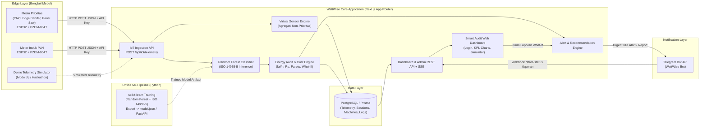
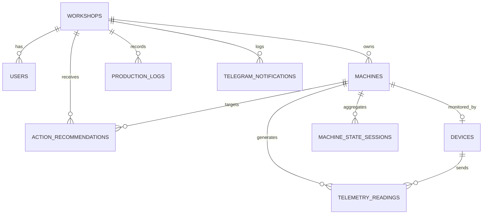

# Technical Architecture — WattWise

> Dokumen arsitektur teknis untuk **WattWise (Smart Energy Audit System)** yang mengimplementasikan kebutuhan pada [PRD.md](./PRD.md). Dirancang untuk mendukung **MVP Hackathon Day (4–6 Desember 2026)** sekaligus siap diskalakan menuju **tahap inkubasi 2–3 bengkel mebel (Januari–Mei 2027)**.

---

## 1. Gambaran Umum Arsitektur (System Topology)

WattWise menggunakan arsitektur **modular full-stack** dengan pemisahan tanggung jawab yang jelas antara lapisan *Edge IoT*, *Ingestion & Analytics*, *Machine Learning*, *Dashboard Web*, dan *Telegram Notification*.



---

## 2. Keputusan Arsitektur & Tech Stack (ADR)

| Komponen | Pilihan Teknologi | Alasan Teknis |
| :--- | :--- | :--- |
| **Web & API Framework** | **Next.js 16 (App Router) + TypeScript + Tailwind CSS v4** | Satu codebase untuk Web Dashboard + REST API + SSE stream. Cepat dideploy ke Vercel/VPS dan cocok dengan keahlian tim software. |
| **ORM & Database** | **PostgreSQL (Managed via Supabase / Neon) + Prisma ORM** *(+ Docker Postgres lokal untuk dev/backup offline)* | Zero-maintenance untuk tim 1 software dev, aman untuk *concurrent write* dari banyak node ESP32, dilengkapi GUI tabel (Supabase) bagi tim validasi/hardware, dan tetap portabel tanpa *vendor lock-in* via Prisma (`DATABASE_URL` + `DIRECT_URL`). |
| **ML Inference (Random Forest)** | **Hybrid: Training Python (`scikit-learn`) → Export JSON Tree Evaluator di TypeScript** *(opsional FastAPI microservice)* | Model dilatih secara ilmiah di Python (`scikit-learn` Random Forest), lalu diekspor menjadi representasi *decision trees* JSON agar inferensi dapat berjalan **0 ms network overhead** langsung di backend Next.js tanpa menambah server tambahan saat demo Hackathon. |
| **Real-Time Update** | **Server-Sent Events (SSE) `/api/stream`** + fallback polling 3 detik | Lebih ringan daripada WebSocket server terpisah, bekerja langsung di Next.js Route Handlers dan stabil di jaringan bengkel. |
| **Visualisasi Dashboard** | **Recharts** + **Lucide React** | Komponen React deklaratif untuk Donut Chart (Status ISO), Horizontal Bar Chart (Pareto), dan grafik tren daya bertema *dark mode*. |
| **Autentikasi** | **JWT Session (`httpOnly` cookie via `jose` + `bcryptjs`)** & **Device API Key** | Sesi aman untuk pengguna Dashboard (`OWNER`, `TECHNICIAN`, `ADMIN`), dan header `X-API-Key` ringan untuk mikrokontroler ESP32. |
| **Notifikasi** | **Telegram Bot API** (Webhook + Outbound Dispatcher) | Tidak perlu aplikasi mobile terpisah; langsung familiar bagi pemilik UMKM mebel untuk menerima laporan Rupiah & alert *idle*. |

---

## 3. Desain Skema Database (ERD)



### Definisi Tabel Utama

#### 1. `workshops`
Menyimpan profil bengkel mebel dan parameter tarif listrik.
| Kolom | Tipe | Keterangan |
| :--- | :--- | :--- |
| `id` | `UUID (PK)` | ID unik bengkel |
| `name` | `VARCHAR(120)` | Nama bengkel (mis. *Area Produksi Furnitur — Sukoharjo*) |
| `location` | `VARCHAR(200)` | Alamat / lokasi bengkel |
| `tariff_idr_per_kwh` | `DECIMAL(10,2)` | Tarif listrik PLN (default mis. `1444.70` atau `1699.53` Rp/kWh sesuai golongan) |
| `working_days_per_month` | `INT` | Jumlah hari kerja/bulan (default `26`) untuk proyeksi *What-If* |
| `telegram_chat_id` | `VARCHAR(64)` | Chat ID pemilik/grup teknisi untuk laporan & alert |
| `created_at` | `TIMESTAMPTZ` | Waktu pembuatan |

#### 2. `users`
| Kolom | Tipe | Keterangan |
| :--- | :--- | :--- |
| `id` | `UUID (PK)` | ID pengguna |
| `workshop_id` | `UUID (FK)` | Relasi ke `workshops` |
| `username` | `VARCHAR(64) UNIQUE` | Username login |
| `password_hash` | `TEXT` | Hash bcrypt |
| `full_name` | `VARCHAR(120)` | Nama tampil (mis. *Pemilik Pabrik / Admin Utama*) |
| `role` | `ENUM` | `OWNER`, `TECHNICIAN`, `ADMIN` |
| `created_at` | `TIMESTAMPTZ` | Waktu pembuatan |

#### 3. `machines`
Mewakili tiap mesin produksi beserta klasifikasi *Matrix Energy Portfolio* (Lampiran 1) dan profil daya.
| Kolom | Tipe | Keterangan |
| :--- | :--- | :--- |
| `id` | `UUID (PK)` | ID mesin |
| `workshop_id` | `UUID (FK)` | Relasi ke `workshops` |
| `code` | `VARCHAR(40)` | Kode singkat (mis. `CNC-1325`, `EDGE-01`, `PSAW-01`, `VIRTUAL-NONCRIT`) |
| `name` | `VARCHAR(120)` | Nama mesin (mis. *CNC Router 1325*, *Edge Bander Auto*, *Panel Saw Sliding*) |
| `machine_type` | `VARCHAR(60)` | Jenis mesin (`CNC`, `EDGE_BANDER`, `PANEL_SAW`, `DUST_COLLECTOR`, `BORING`, `COMPRESSOR`, `VIRTUAL_AGGREGATE`) |
| `rated_power_w` | `FLOAT` | Daya nominal katalog/nameplate (Watt) |
| `annual_operating_hours` | `FLOAT` | Estimasi jam operasi/tahun (sumbu X *Matrix Energy Portfolio*) |
| `portfolio_quadrant` | `ENUM` | `CRITICAL`, `LEVERAGE_POWER`, `LEVERAGE_TIME`, `NONCRITICAL` |
| `has_physical_sensor` | `BOOLEAN` | `true` jika terpasang node PZEM-004T, `false` jika diestimasi *Virtual Sensor* |
| `idle_alert_threshold_min` | `INT` | Ambang durasi *idle* kontinu (menit) sebelum kirim alert *urgent* Telegram (default `20`) |
| `baseline_idle_w` | `FLOAT` | Referensi daya *idle* untuk kalibrasi/fallback |
| `baseline_working_w` | `FLOAT` | Referensi daya *working* untuk kalibrasi/fallback |
| `is_active` | `BOOLEAN` | Status aktif mesin |

#### 4. `devices`
Mewakili perangkat keras node ESP32 + PZEM-004T (termasuk node Meter Induk).
| Kolom | Tipe | Keterangan |
| :--- | :--- | :--- |
| `id` | `UUID (PK)` | ID device |
| `workshop_id` | `UUID (FK)` | Relasi ke `workshops` |
| `machine_id` | `UUID (FK, NULL)` | Mesin terkait (`NULL` jika `is_main_meter = true`) |
| `device_uid` | `VARCHAR(64) UNIQUE` | ID perangkat (mis. `ESP32-CNC-01`, `ESP32-MAIN-01`) |
| `api_key_hash` | `TEXT` | Hash API key perangkat untuk autentikasi ingest |
| `is_main_meter` | `BOOLEAN` | `true` untuk node sensor Meter Induk PLN |
| `firmware_version` | `VARCHAR(32)` | Versi firmware ESP32 |
| `last_seen_at` | `TIMESTAMPTZ` | Timestamp *heartbeat* terakhir (menentukan indikator `ESP32 Online/Offline`) |

#### 5. `telemetry_readings`
Data pengukuran mentah & hasil klasifikasi status per interval (mis. tiap 5 detik).
> **Index:** `(machine_id, recorded_at DESC)` dan `(device_id, recorded_at DESC)`.

| Kolom | Tipe | Keterangan |
| :--- | :--- | :--- |
| `id` | `BIGSERIAL (PK)` | ID pembacaan |
| `device_id` | `UUID (FK, NULL)` | Node pengirim (`NULL` untuk record hasil kalkulasi Virtual Sensor) |
| `machine_id` | `UUID (FK)` | Mesin terkait |
| `recorded_at` | `TIMESTAMPTZ` | Timestamp pengukuran |
| `voltage_v` | `FLOAT` | Tegangan RMS (Volt) |
| `current_a` | `FLOAT` | Arus RMS (Ampere) |
| `power_w` | `FLOAT` | Daya aktif (Watt) |
| `energy_kwh` | `FLOAT` | Akumulator energi dari PZEM-004T (kWh) |
| `frequency_hz` | `FLOAT` | Frekuensi listrik (Hz) |
| `power_factor` | `FLOAT` | Faktor daya (`0.0 - 1.0`) |
| `predicted_status` | `ENUM` | `OFF`, `START_UP`, `IDLE`, `WORKING` |
| `status_confidence` | `FLOAT` | Probabilitas/confidence Random Forest (`0.0 - 1.0`) |
| `is_simulated` | `BOOLEAN` | `true` jika berasal dari simulator demo |

#### 6. `machine_state_sessions`
Agregasi interval status kontinu untuk query KPI, Pareto, dan durasi yang sangat cepat.
> **Index:** `(machine_id, started_at DESC)` dan `(status, started_at DESC)`.

| Kolom | Tipe | Keterangan |
| :--- | :--- | :--- |
| `id` | `UUID (PK)` | ID sesi status |
| `machine_id` | `UUID (FK)` | Relasi ke `machines` |
| `status` | `ENUM` | `OFF`, `START_UP`, `IDLE`, `WORKING` |
| `started_at` | `TIMESTAMPTZ` | Waktu mulai status |
| `ended_at` | `TIMESTAMPTZ` | Waktu berakhir (`NULL` jika masih berlangsung) |
| `duration_sec` | `INT` | Total durasi (detik) |
| `avg_power_w` | `FLOAT` | Rata-rata daya selama sesi |
| `energy_kwh` | `FLOAT` | Total energi pada sesi ini |
| `cost_idr` | `DECIMAL(12,2)` | Estimasi biaya listrik (Rp) pada sesi ini |

#### 7. `production_logs`
Mendukung indikator proposal: **kWh per produk sejenis / unit output** pada evaluasi *baseline* vs pasca-intervensi.
| Kolom | Tipe | Keterangan |
| :--- | :--- | :--- |
| `id` | `UUID (PK)` | ID log produksi |
| `workshop_id` | `UUID (FK)` | Relasi ke `workshops` |
| `product_category` | `VARCHAR(100)` | Jenis produk (mis. *Meja Makan Jati*, *Lemari 2 Pintu*) |
| `output_units` | `INT` | Jumlah unit produksi |
| `period_date` | `DATE` | Tanggal produksi |
| `notes` | `TEXT` | Catatan tambahan |

#### 8. `action_recommendations`
Menyimpan riwayat **Log Tindakan Otomatisasi** di Dashboard.
| Kolom | Tipe | Keterangan |
| :--- | :--- | :--- |
| `id` | `UUID (PK)` | ID rekomendasi |
| `workshop_id` | `UUID (FK)` | Relasi ke `workshops` |
| `machine_id` | `UUID (FK)` | Mesin target |
| `recommendation_text` | `TEXT` | Saran tindakan (mis. *Matikan motor utama saat jeda > 15 menit*) |
| `status` | `ENUM` | `PENDING`, `COMPLETED`, `DISMISSED` |
| `estimated_saving_idr` | `DECIMAL(12,2)` | Estimasi penghematan bulanan (Rp) |
| `created_at` | `TIMESTAMPTZ` | Tanggal rekomendasi muncul |
| `completed_at` | `TIMESTAMPTZ` | Waktu penyelesaian |

#### 9. `telegram_notifications`
Audit trail pengiriman pesan ke `WattWise Bot` sekaligus mencegah spam (*cooldown*).
| Kolom | Tipe | Keterangan |
| :--- | :--- | :--- |
| `id` | `UUID (PK)` | ID log |
| `workshop_id` | `UUID (FK)` | Relasi ke `workshops` |
| `machine_id` | `UUID (FK, NULL)` | Mesin pemicu (jika tipe alert) |
| `notification_type` | `ENUM` | `URGENT_IDLE`, `DAILY_SUMMARY`, `WHAT_IF_REPORT` |
| `message_body` | `TEXT` | Isi pesan yang dikirim |
| `delivery_status` | `ENUM` | `SENT`, `FAILED` |
| `sent_at` | `TIMESTAMPTZ` | Waktu kirim |

---

## 4. Pipeline Data, ML & Algoritma Inti

### 4.1 Kontrak Payload Telemetri ESP32 (`POST /api/iot/telemetry`)

Setiap node ESP32 membaca sensor PZEM-004T tiap 1 detik, merata-ratakan pada jendela 5 detik, lalu mengirim payload JSON via HTTP POST (atau batch array jika baru pulih dari putus Wi-Fi):

```json
// Header:
// Content-Type: application/json
// X-Device-UID: ESP32-CNC-01
// X-API-Key: ww_dev_xxxxxxxxxxxxxxxxx

{
  "device_uid": "ESP32-CNC-01",
  "recorded_at": "2026-12-04T09:15:05Z",
  "metrics": {
    "voltage_v": 221.4,
    "current_a": 4.82,
    "power_w": 985.5,
    "energy_kwh": 142.318,
    "frequency_hz": 50.0,
    "power_factor": 0.92
  },
  "firmware_version": "1.0.0"
}
```

### 4.2 Algoritma Virtual Sensor (Agregasi Mesin Non-Prioritas)
Saat pembacaan dari node **Meter Induk** (`is_main_meter = true`) masuk pada *time bucket* $t$ (pembulatan jendela 5 detik):
1. Ambil pembacaan terbaru ($\le 15$ detik terakhir) dari seluruh mesin prioritas (`has_physical_sensor = true`) di bengkel yang sama.
2. Hitung estimasi daya agregat mesin non-prioritas:
   $$P_{\text{virtual}}(t) = \max\left(0,\; P_{\text{induk}}(t) - \sum_{i \in \text{Prioritas}} P_i(t)\right)$$
3. Simpan sebagai record pada mesin agregat `VIRTUAL_AGGREGATE` sehingga total konsumsi di KPI Dashboard tetap konsisten dengan tagihan meter induk.

### 4.3 Klasifikasi Status Mesin — Random Forest (ISO 14955-5)

Mengacu pada standar **ISO 14955-5:2020** untuk mesin perkayuan dan rancangan Random Forest (Jinguji et al., 2018):

**Fitur Input (*Feature Engineering* dari jendela 3 pembacaan terakhir / 15 detik):**
1. `power_ratio` = $P(t) / P_{\text{rated}}$ (menormalisasi antar mesin dengan kapasitas daya berbeda).
2. `current_a` = arus aktual (Ampere).
3. `power_factor` = faktor daya (motor induksi saat *idle*/tanpa beban umumnya memiliki *power factor* jauh lebih rendah dibandingkan saat memotong material!).
4. `delta_power_w` = $P(t) - P(t-1)$ (mendeteksi lonjakan *inrush/start-up*).
5. `rolling_std_w` = standar deviasi daya pada 3–5 sampel terakhir (saat *working* / pemotongan kayu beban berfluktuasi; saat *idle* daya relatif datar/stabil).
6. `rolling_mean_ratio` = rata-rata `power_ratio` pada jendela geser.

**Output 4 Kelas Status:**
- `OFF`: $P(t) < 2\%$ dari $P_{\text{rated}}$ (atau $< 15\text{ W}$).
- `START_UP`: Lonjakan transien `delta_power_w` tinggi saat transisi dari `OFF` (berlangsung 5–30 detik).
- `IDLE`: Motor menyala tanpa beban pemotongan (`power_ratio` rendah–menengah, `power_factor` rendah, `rolling_std_w` stabil/rendah).
- `WORKING`: Mesin aktif memproses material (`power_ratio` menengah–tinggi, `power_factor` tinggi, `rolling_std_w` dinamis).

**Hysteresis / State Smoothing:**
Transisi dari `WORKING` → `IDLE` baru dikunci ke `machine_state_sessions` setelah 2 sampel berturut-turut (10 detik) agar jeda ganti papan kayu singkat tidak dihitung sebagai *idle* palsu.

**Alur Model ML:**
- `ml/train_rf.py` melatih `RandomForestClassifier` dengan `scikit-learn` (dataset simulasi realistis profil mesin kayu + data lapangan saat validasi) dan mengevaluasi akurasi / *confusion matrix*.
- `ml/export_model.py` mengekspor seluruh *decision trees* menjadi `src/lib/ml/rf-model.json`.
- `src/lib/ml/classifier.ts` mengeksekusi voting *ensemble* Random Forest langsung di Node.js/TypeScript secara deterministik dan sangat cepat (< 1 ms/prediksi).

### 4.4 Rumus Audit Energi, Efisiensi ISO & Simulator "What-If"

1. **Energi Sesi:**
   $$E_{\text{sesi}} (\text{kWh}) = \frac{\overline{P}_{\text{sesi}} (\text{W}) \times \text{duration\_sec}}{3{,}600{,}000}$$
2. **Estimasi Kerugian Daya Idle (Rp):**
   $$\text{Kerugian Idle} = \left(\sum E_{\text{idle}}\right) \times \text{Tarif}_{\text{Rp/kWh}}$$
3. **Efisiensi Daya Operasional (berbasis ISO 14955-5):**
   $$\eta_{\text{operasional}} = \frac{E_{\text{working}}}{E_{\text{working}} + E_{\text{idle}} + E_{\text{startup}}} \times 100\%$$
   - $\ge 75\%$: *Sangat Baik* | $60\%–74\%$: *Baik* | $45\%–59\%$: *Perlu Perbaikan* | $< 45\%$: *Boros*
4. **Konsumsi Energi Spesifik (Evaluasi Baseline vs Pasca-Intervensi):**
   $$\text{SEC} = \frac{E_{\text{total}}\;(\text{kWh})}{\text{Jumlah Unit Produk Sejenis}}$$
5. **Simulator Hemat "What-If" (Bulanan):**
   $$\text{Hemat}_{\text{idle}} = \left(\frac{\Delta t_{\text{idle/hari}}}{60}\right) \times \overline{P}_{\text{idle,kW}} \times H_{\text{kerja/bulan}} \times \text{Tarif}_{\text{Rp/kWh}}$$
   $$\text{Hemat}_{\text{startup}} = \Delta N_{\text{startup/bulan}} \times \overline{E}_{\text{startup,kWh}} \times \text{Tarif}_{\text{Rp/kWh}}$$
   $$\text{Estimasi Penghematan Tambahan} = \text{Hemat}_{\text{idle}} + \text{Hemat}_{\text{startup}}$$

---

## 5. Kontrak REST API (Next.js App Router)

| Domain | Method & Endpoint | Fungsi Utama | Auth |
| :--- | :--- | :--- | :--- |
| **Auth** | `POST /api/auth/login` | Login user & set `httpOnly` session cookie | Public |
| **Auth** | `POST /api/auth/logout` | Hapus sesi | Session |
| **Auth** | `GET /api/auth/me` | Profil user + status koneksi ESP32 (`Online/Offline`) | Session |
| **IoT** | `POST /api/iot/telemetry` | Ingest telemetri dari ESP32 (+ klasifikasi RF + Virtual Sensor) | `X-API-Key` |
| **IoT** | `GET /api/iot/devices/status` | Status *heartbeat* semua node ESP32 | Session |
| **Dashboard** | `GET /api/dashboard/overview?range=month` | KPI Cards (Kerugian Idle, Efisiensi ISO, Total kWh), Proporsi ISO, Pareto | Session |
| **Dashboard** | `GET /api/machines` | Daftar mesin + status live terkini + filter (`all`, `working`, `idle`, `off`) | Session |
| **Dashboard** | `GET /api/machines/[id]/telemetry` | Grafik historis daya & sesi status per mesin | Session |
| **Dashboard** | `GET /api/stream` | SSE stream untuk pembaruan status mesin & daya secara *real-time* | Session |
| **Actions** | `GET /api/recommendations` | Daftar **Log Tindakan Otomatisasi** | Session |
| **Actions** | `PATCH /api/recommendations/[id]` | Ubah status tindakan (`PENDING` → `COMPLETED`) | Session |
| **Simulator** | `POST /api/simulator/what-if` | Hitung estimasi penghematan bulanan dari parameter slider | Session |
| **Simulator** | `POST /api/simulator/demo-tick` | *(Mode Demo)* Memicu atau toggle stream data simulasi realistis | Session |
| **Telegram** | `POST /api/telegram/webhook` | Handler perintah `/start`, `/status`, `/laporan` dari Telegram | Webhook Secret |
| **Telegram** | `POST /api/telegram/send-report` | Kirim laporan ringkas / hasil *What-If* dari Dashboard ke Telegram | Session |
| **Export** | `GET /api/export/audit?format=csv` | Ekspor data audit energi & sesi mesin ke CSV | Session |

---

## 6. Struktur Folder Repositori

```text
wattwise/
├── PRD.md                          # Product Requirements Document
├── ARCHITECTURE.md                 # Dokumen arsitektur teknis ini
├── docker-compose.yml              # PostgreSQL lokal (dev / backup offline Hackathon)
├── .env.example                    # Template DATABASE_URL, DIRECT_URL, JWT, Telegram
├── prisma/
│   ├── schema.prisma               # Skema database PostgreSQL (Prisma ORM)
│   └── seed.ts                     # Data awal 6 mesin furnitur + riwayat baseline
├── ml/                             # Pipeline Machine Learning (Python)
│   ├── generate_dataset.py         # Generator dataset profil daya ISO 14955-5
│   ├── train_rf.py                 # Training & evaluasi Random Forest (scikit-learn)
│   └── export_model.py             # Export ensemble tree -> src/lib/ml/rf-model.json
├── firmware/                       # Kode contoh ESP32 + PZEM-004T (kolaborasi Hardware)
│   └── esp32_pzem_wattwise/
├── src/
│   ├── app/
│   │   ├── login/page.tsx          # Halaman Login + status koneksi ESP32
│   │   ├── dashboard/page.tsx      # Dashboard Utama "Smart Audit"
│   │   ├── machines/[id]/page.tsx  # Rincian energi per mesin
│   │   ├── settings/page.tsx       # Pengaturan tarif, Matrix Portfolio, Telegram
│   │   └── api/                    # REST API & SSE Route Handlers
│   │       ├── auth/
│   │       ├── iot/telemetry/
│   │       ├── dashboard/overview/
│   │       ├── machines/
│   │       ├── recommendations/
│   │       ├── simulator/
│   │       ├── telegram/
│   │       ├── export/
│   │       └── stream/
│   ├── components/
│   │   ├── layout/                 # Topbar, search Ctrl+K, live badge
│   │   ├── dashboard/              # KPI Cards, Machine Grid, ISO Donut, Pareto Bar
│   │   ├── actions/                # Action Log Table
│   │   └── simulator/              # What-If Slider & Telegram trigger
│   └── lib/
│       ├── db.ts                   # Prisma client singleton
│       ├── auth.ts                 # Session JWT & password helper
│       ├── ml/
│       │   ├── features.ts         # Sliding window feature engineering
│       │   ├── classifier.ts       # Random Forest JSON evaluator + hysteresis
│       │   └── rf-model.json       # Trained Random Forest model artifact
│       ├── audit/
│       │   ├── virtual-sensor.ts   # Perhitungan beban non-prioritas
│       │   ├── calculator.ts       # kWh, Rupiah, ISO Efficiency, What-If
│       │   └── recommendations.ts  # Generator rekomendasi aksi & alert cooldown
│       ├── simulator/
│       │   └── furniture-sim.ts    # Simulator profil daya 6 mesin mebel
│       └── telegram/
│           └── bot.ts              # Formatter pesan & Telegram Bot API client
```

---

## 7. Keamanan, Keandalan & Strategi Demo Hackathon

1. **Keamanan:**
   - Semua secret (`DATABASE_URL`, `JWT_SECRET`, `TELEGRAM_BOT_TOKEN`, `TELEGRAM_WEBHOOK_SECRET`) disimpan di `.env` (tidak di-commit ke Git).
   - Endpoint ingest ESP32 diverifikasi dengan `X-Device-UID` + `X-API-Key` (disimpan ter-hash di database).
   - Validasi seluruh input API menggunakan `zod`.
2. **Keandalan Jaringan Bengkel:**
   - **ESP32 Offline Buffer:** Firmware menyimpan hingga ~50 pembacaan di RAM/ring-buffer jika Wi-Fi terputus sementara, lalu mengirim *batch* saat tersambung kembali.
   - **Heartbeat Detection:** Device dianggap `OFFLINE` jika `now - last_seen_at > 30 detik`.
   - **Alert Cooldown:** Notifikasi *urgent idle* ke Telegram dibatasi minimal jeda 30 menit per mesin agar tidak mengganggu pemilik usaha.
3. **Resiliensi Demo Hackathon Day (4–6 Desember 2026):**
   - Mendukung **Dual Mode** (`LIVE_IOT` dan `DEMO_SIMULATOR`):
     - Saat node ESP32 nyata tersambung, data sensor langsung masuk ke pipeline utama secara *real-time*.
     - Tersedia tombol/skenario **Simulator Demo** untuk memicu skenario *idle* pada *Edge Bander* / *CNC Router* dan memperlihatkan klasifikasi Random Forest, pembaruan grafik Pareto, simulator *What-If*, hingga masuknya pesan notifikasi ke **Telegram Bot** secara instan di depan juri.

---

## 8. Topologi Deployment (Bertahap)

| Fase | Hosting App & API | Database | ML Inference | Estimasi Biaya |
| :--- | :--- | :--- | :--- | :--- |
| **MVP Hackathon (Des 2026)** | Vercel / VPS + Next.js | Managed PostgreSQL (Supabase / Neon) + Docker Postgres backup | In-process JSON Random Forest (Node.js) | Gratis (*free tier*) |
| **Inkubasi 2–3 Bengkel (Jan–Mei 2027)** | Vercel / VPS (Docker Compose) | Managed PostgreSQL (Supabase / Neon) + *30-day raw retention* | In-process + pipeline retraining Python berkala | Gratis–rendah (mendukung model langganan UMKM) |
| **Skala Komersial (> 20 Bengkel)** | Containerized App + Worker Queue | PostgreSQL + TimescaleDB | Dedicated Python ML/LLM Recommendation Service | Skalabel per tenant bengkel |

### Strategi Efisiensi Penyimpanan PostgreSQL (*Free Tier Friendly*)
- **`telemetry_readings` (mentah per 5 detik):** Menggunakan kebijakan *rolling retention* 30 hari (~30–50 MB/bulan per bengkel).
- **`machine_state_sessions` (ringkasan sesi status):** Disimpan permanen dengan ukuran sangat kecil untuk analisis *baseline* vs pasca-intervensi jangka panjang.
- **Connection Pooling:** Menggunakan `DATABASE_URL` (pooled/PgBouncer) untuk runtime serverless/Next.js dan `DIRECT_URL` (direct connection) khusus perintah migrasi Prisma (`prisma migrate`).
